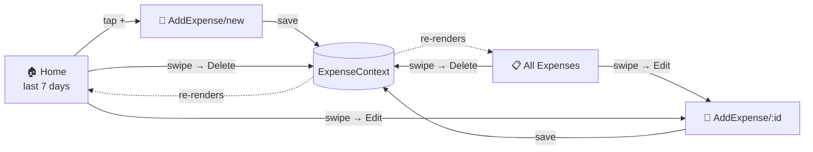

<div align="center">

# 💸 ReactExpense

**Track where your money goes — one swipe at a time.**

A sleek, cross-platform expense tracker built with **Expo Router**, **React Native** and **TypeScript**.
Runs on iOS, Android and the web from a single codebase.


</div>

---

## ✨ Features

| | Feature | What it does |
|---|---|---|
| 🏠 | **Recent Expenses** | The Home tab shows only what you've spent in the **last 7 days**. |
| 📋 | **All Expenses** | A dedicated tab with your complete spending history. |
| ➕ | **Quick Add** | Tap the **+** in the header to log a new expense with a title, amount and date. |
| 👈 | **Swipe Actions** | Swipe any expense left to reveal **Edit** and **Delete**. |
| ✏️ | **Edit in Place** | Editing reuses the same form, pre-filled with the expense's details. |
| 📅 | **Native Date Picker** | Pick dates with the platform's own picker via `@expo/ui`. |
| 🌗 | **Automatic Theme** | Follows the device's light/dark setting. |

---

## 🧭 How it flows



All screens share a single source of truth: **`ExpenseContext`**, a React Context exposing
`expenses`, `addExpense`, `updateExpense` and `deleteExpense`.

---

## 🗂️ Project structure

```
src/
├── app/                          # Expo Router (file-based routing)
│   ├── _layout.tsx               # Root Stack + GestureHandler + ExpenseProvider
│   ├── (tabs)/
│   │   ├── _layout.tsx           # Bottom tabs + "+" header button
│   │   ├── index.tsx             # 🏠 Home — recent (7-day) expenses
│   │   └── AllExpenses.tsx       # 📋 Full expense history
│   └── AddExpense/
│       └── [id].tsx              # 📝 Add (id = "new") or edit (id = expense id)
├── component/
│   └── ExpenseList.tsx           # FlatList + ReanimatedSwipeable rows
├── Context/
│   └── ExpenseContext.tsx        # Global expense state & actions
├── model/
│   └── ExpenseModel.tsx          # Expense interface
└── global.css                    # Web font tokens
```

### 🧱 The data model

```ts
interface Expense {
  id: string;
  title: string;
  amount: number;
  date: Date;
}
```

---

## 🚀 Getting started

**Prerequisites:** Node.js (LTS) and npm. For devices, install [Expo Go](https://expo.dev/go) or set up a simulator/emulator.

```bash
# 1. Install dependencies
npm install

# 2. Fire it up
npx expo start
```

Then press **`i`** for iOS, **`a`** for Android, **`w`** for web — or scan the QR code with Expo Go.

### 📜 Scripts

| Command | Description |
|---|---|
| `npm start` | Start the Expo dev server |
| `npm run ios` | Launch on the iOS simulator |
| `npm run android` | Launch on an Android emulator/device |
| `npm run web` | Run in the browser |
| `npm run lint` | Lint with Expo's ESLint config |

---

## 🛠️ Tech stack

- **[Expo SDK 57](https://docs.expo.dev/versions/v57.0.0/)** with the **React Compiler** and **typed routes** enabled
- **[Expo Router](https://docs.expo.dev/router/introduction/)** — Stack + Tabs navigation
- **[React Native Gesture Handler](https://docs.swmansion.com/react-native-gesture-handler/)** & **[Reanimated](https://docs.swmansion.com/react-native-reanimated/)** — buttery swipe rows
- **[@expo/ui](https://docs.expo.dev/versions/v57.0.0/sdk/ui/)** — native date picker
- **[FontAwesome Free Solid](https://github.com/oblador/react-native-vector-icons)** — tab and header icons

---

## 🗺️ Roadmap

- [ ] 💾 Persist expenses across restarts (currently held in memory only)
- [ ] 🏷️ Categories & filters
- [ ] 📊 Spending totals and charts
- [ ] ✅ Form validation for title and amount
- [ ] 💱 Multi-currency support

---

## 📄 License

Released under the [MIT License](./LICENSE).

<div align="center">

Made with ☕ and ⚛️

</div>
